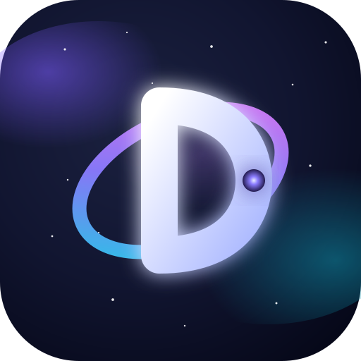

# Top Up Diamond MLBB — Daffa ML Store

Halaman login / top up **Mobile Legends: Bang Bang** yang siap pakai sebagai
halaman Hotspot MikroTik (atau halaman standalone) — desain gelap futuristik, keranjang
diaman otomatis, harga promo produk diamond lengkap, dan info donasi.



## Fitur

- Grid paket diamond MLBB (5💎 – 5700💎) — klik untuk tambah ke keranjang
- Kalkulasi total otomatis
- Form login MikroTik-ready (`$(link-login-only)` & `$(link-orig)`) — bisa dipakai
  sebagai `login.html` di RouterOS Hotspot atau sebagai halaman web biasa
- Tema gelap neon (biru/magenta/kuning) — **tidak jadul**
- Bahasa Indonesia, responsive mobile &amp; desktop
- Info donasi a/n **Daffiyanet** — bantu mendukung kamu &amp; proyek ini
- Satu file mandiri (`mlbb.html` + `logo.png`)

## Preview

Buka `mlbb.html` di browser untuk melihat tampilan &amp; klik paket diamond untuk mencobanya.

## Per-tema (RouterOS Terminal)

Jika ingin dipakai sebagai halaman login Hotspot MikroTik Anda:

```
/tool fetch mode=https url="https://raw.githubusercontent.com/Indra725/topup-diamond-mlbb/main/mlbb.html" dst-path="hotspot/mlbb.html"
/tool fetch mode=https url="https://raw.githubusercontent.com/Indra725/topup-diamond-mlbb/main/logo.png" dst-path="hotspot/logo.png"
/ip hotspot profile set [find name=default] login-page=mlbb.html
```

Atau lewat Winbox: upload `mlbb.html` &amp; `logo.png` ke folder `hotspot/`,
lalu set `login-page=mlbb.html` di hotspot profile `default`.

## Kustomisasi

| Bagian | Lokasi | Cara ubah |
|---|---|---|
| Daftar paket diamond | `const PACKAGES = [...]` di dalam `<script>` | Edit array (nama, harga, icon) |
| Total keranjang | `.cart` &amp; `#cartTotal` | Otomatis dihitung |
| Logo | `logo.png` | Ganti dengan logo/brand Anda |
| Kontak &amp; nomor | `footer`, `.topbar` | Edit sesuai kebutuhan |
| Warna tema | `:root` CSS vars | Edit hex sesuai selera |

## Dukungan / Donasi

Setiap dukungan Anda sangat berarti &amp; membantu kelangsungan proyek ini:

- **Halaman donasi:** https://indra725.github.io/donasi/
- **QRIS:** scan dari semua e-wallet / m-banking (DAFFIYANET, Konter — NMID ID1025401523762)
- **E-Wallet (DANA / GoPay / OVO / ShopeePay):** **08516163719** a/n **Daffiyanet**
- **WhatsApp:** https://wa.me/628516163719

## Lisensi

MIT — lihat berkas `LICENSE`.
